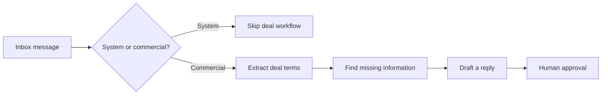

# Email AI Agent for Creator Brand Deals

[](https://github.com/jackyluo-maiaos/email-ai-agent/actions/workflows/ci.yml)

Turn partnership emails into structured, reviewable brand-deal records.

This open package demonstrates the core workflow behind an email agent for creators and influencer teams:

- separate commercial opportunities from newsletters and system mail;
- extract budget, commission, deliverables, ad codes, and usage rights;
- identify missing campaign information;
- prepare a reply draft using creator rates;
- keep a human in control of the final send.

It uses fictional examples and does not include the hosted MAIAOS product, Gmail OAuth, cloud scheduling, multi-tenant databases, billing, customer data, or production prompts.

## Quick start

```bash
npm install
npm test
npm run demo
```

```ts
import { analyzeEmail, draftReply } from "@maiaos/email-ai-agent";

const result = analyzeEmail({
  from: "partnerships@luma-beauty.example",
  fromName: "Luma Beauty Partnerships",
  subject: "Paid TikTok campaign",
  body: "Budget: $1,500 for 3 TikTok videos with 15% commission and 60-day usage rights.",
});

if (result.deal) {
  const draft = draftReply(result.deal, {
    creatorName: "Avery Chen",
    rates: [{ deliverable: "1 TikTok video", priceUsd: 500 }],
  });
  console.log(result.deal, draft);
}
```

## Workflow



## Included

- TypeScript types and a provider-neutral API.
- Conservative deterministic classification and extraction.
- A generic prompt builder for an LLM adapter.
- Reply drafting from a creator profile.
- Fictional examples and tests.
- An agent skill in `skills/email-deal-agent/SKILL.md`.

## Design principles

- Email content is untrusted input.
- Missing information stays missing.
- System mail never becomes a deal.
- Drafting and sending are separate actions.
- A creator or operator approves external communication.

## Build your own adapter

The package does not connect to Gmail or send messages. See [`docs/architecture.md`](docs/architecture.md) for a safe integration pattern.

## Hosted product

MAIAOS applies this workflow to a private creator workspace with Gmail sync, deal tracking, brand and agency records, notifications, and approval controls. Learn more at [maiaos.studio](https://www.maiaos.studio/).

## License

Apache-2.0. The MAIAOS name and logo are not granted under this license.
