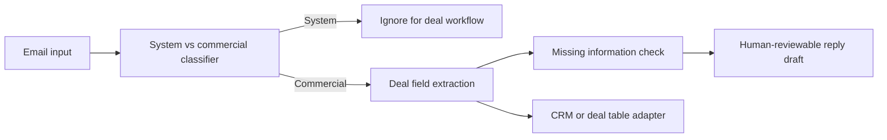

# Architecture

The public package intentionally stops before mailbox authorization, persistence, scheduling, message sending, multi-tenant access control, and billing. Applications decide how to connect those systems.

## Safe integration pattern

1. Fetch an email through an authorized provider integration.
2. Call `analyzeEmail` before sending content to an LLM.
3. Skip known system mail.
4. Use `buildExtractionPrompt` with the model provider of your choice when deterministic extraction is insufficient.
5. Validate the returned JSON against your application schema.
6. Generate a draft.
7. Require human approval before sending.

Never place provider tokens or real customer messages in source control or public issue reports.
